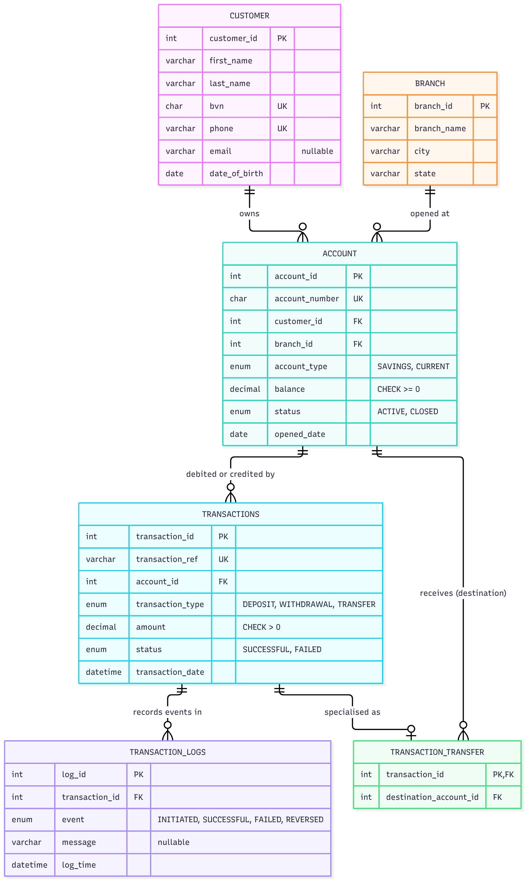

# Portfolio 1: Database Design and Modelling

**Case study:** ArcLedger Digital Bank, a simulated Nigerian retail bank ([case-study.md](case-study.md))
**DBMS:** MySQL 8.0 (InnoDB). Tested on MySQL 8.0.46.

## Contents
| Deliverable | Where |
|---|---|
| Chosen case study description | [case-study.md](case-study.md) |
| ER diagram | [diagrams/arcledger_erd.png](diagrams/arcledger_erd.png) (also `.svg` and Mermaid source `.mmd`) |
| Relational schema, keys and constraints | [sql/01_schema.sql](sql/01_schema.sql), summarised below |
| Normalisation explanation | [normalisation.md](normalisation.md) |
| Data generation | [sql/03_bulk_seed.sql](sql/03_bulk_seed.sql), main load: generates ≈1.8M rows with `INSERT … SELECT` ([output](evidence/03_bulk_seed_output.txt)). Optional: [sql/02_seed.sql](sql/02_seed.sql), 11 hand-written transactions small enough to check by hand |
| Constraint tests | [sql/04_constraint_tests.sql](sql/04_constraint_tests.sql) → [evidence/04_constraint_tests_output.txt](evidence/04_constraint_tests_output.txt) |
| Verification queries | [sql/05_verify.sql](sql/05_verify.sql) → [evidence/05_verify_output.txt](evidence/05_verify_output.txt) |

## How to run
```bash
mysql -u root -p < sql/01_schema.sql                      # create the 6 tables
mysql -u root -p arcledger < sql/03_bulk_seed.sql         # generate the data (≈40 s)
mysql -u root -p --force -vvv arcledger < sql/04_constraint_tests.sql
mysql -u root -p -t arcledger < sql/05_verify.sql
```
`04` and `05` look up real rows from whatever is loaded, so they also work with `02_seed.sql` alone or with both seeds.

### How the data is generated
The data isn't typed in row by row. `03_bulk_seed.sql` generates it:
1. **A numbers table (1 to 1,000,000)** is built by cross-joining the digits 0–9 six times.
2. **Each table is filled with one `INSERT … SELECT`** from the numbers table, in foreign-key order (branch, customer, account, transactions, transaction_transfer, transaction_logs). Realistic values come from `RAND()`, `ELT()` name lists and `LPAD()` for identifiers.
3. **Balances are calculated, not generated:** an `UPDATE` sets each account's balance from its successful transactions, so stored balances always agree with the history (V7).
4. **All constraints stay switched on during the load,** so every one of the ≈1.8M rows has passed the PK/FK/UNIQUE/CHECK rules.

| Table | Rows generated |
|---|---|
| branch | 20 |
| customer | 10,000 |
| account | 15,000 (5,000 customers own two, showing 1:N) |
| transactions | 515,000 (30% deposits, 25% withdrawals, 45% transfers, ~3% failed) |
| transaction_transfer | 225,000 |
| transaction_logs | 1,030,000 (INITIATED + outcome per transaction) |

During development the generator's first version broke `ck_account_balance`: MySQL evaluated `RAND()` more than once per row, so some withdrawals got deposit-sized amounts. The CHECK constraint stopped the load. The fix was to derive the transaction type from `MOD(n, 20)` instead.

## ER diagram


### Entities
| Entity | Grain (one row per…) | Purpose |
|---|---|---|
| `customer` | customer | Who banks with ArcLedger |
| `branch` | branch | Where accounts are opened |
| `account` | account | A savings or current account owned by one customer |
| `transactions` | transaction | Every deposit, withdrawal and transfer (supertype) |
| `transaction_transfer` | transfer | The receiving account, only for transfers (subtype) |
| `transaction_logs` | event | Each step in a transaction's life: initiated, successful, failed |

### Relationships
| Relationship | Cardinality | Implemented by |
|---|---|---|
| Customer **owns** Account | 1 : N | `account.customer_id` FK |
| Branch **opens** Account | 1 : N | `account.branch_id` FK |
| Account **is debited/credited by** Transactions | 1 : N | `transactions.account_id` FK |
| Transactions **is specialised as** Transaction_Transfer | 1 : 0..1 | `transaction_transfer.transaction_id` is both PK and FK |
| Account **receives** Transaction_Transfer | 1 : N | `transaction_transfer.destination_account_id` FK |
| Transactions **records events in** Transaction_Logs | 1 : N | `transaction_logs.transaction_id` FK |

**Design decisions**
- **One `transactions` table for all three kinds of money movement,** told apart by `transaction_type`. Deposits, withdrawals and transfers share almost all their attributes, and a statement is then a query on one table.
- **Transfers as a subtype table** instead of a nullable `destination_account_id` column. This avoids NULLs for 2 of the 3 transaction types (see [normalisation.md](normalisation.md#removing-nulls-the-transfer-subtype)).
- **Separate log table.** `transactions` records *what* happened (final outcome), and `transaction_logs` records *how* (every event). The log never repeats amounts or accounts.
- **No joint accounts:** a deliberate scope decision, which makes Customer → Account 1:N.

## Relational schema
```
customer             (customer_id PK, first_name, last_name, bvn UQ, phone UQ, email, date_of_birth)
branch               (branch_id PK, branch_name, city, state)
account              (account_id PK, account_number UQ, customer_id FK→customer, branch_id FK→branch,
                      account_type, balance, status, opened_date)
transactions         (transaction_id PK, transaction_ref UQ, account_id FK→account,
                      transaction_type, amount, status, transaction_date)
transaction_transfer (transaction_id PK FK→transactions, destination_account_id FK→account)
transaction_logs     (log_id PK, transaction_id FK→transactions, event, message, log_time)
```

## Keys and constraints
| Type | Count | Where and why |
|---|---|---|
| **PRIMARY KEY** | 6 | One surrogate integer key per table. In `transaction_transfer` the PK is also the FK, which makes the relationship 1:1. |
| **UNIQUE** (candidate keys) | 4 | `bvn` and `phone` (one customer per identity), `account_number`, `transaction_ref` (a retried app request can't post twice) |
| **FOREIGN KEY** | 6 | No account without a real customer and branch, no transaction without a real account, no transfer to a non-existent account, no orphan log |
| **CHECK** | 4 | BVN is exactly 11 digits, account number is exactly 10 digits, `balance >= 0`, `amount > 0` |
| **NOT NULL / DEFAULT** | all required columns | e.g. balance defaults to 0.00, status defaults to ACTIVE, dates default to now |
| **ENUM** (domain) | 5 columns | account type and status, transaction type and status, log event |

**Data types:** money is `DECIMAL(15,2)`, never `FLOAT`, because binary floating point can't store values like 0.10 exactly and a bank must be exact to the kobo. Identifiers with leading zeros (account numbers, BVNs) are `CHAR`, not numbers, so the zeros aren't lost.

## Test results
**Constraint tests: 19/19 invalid statements rejected** ([output](evidence/04_constraint_tests_output.txt)). The test values (an existing BVN, account number or transfer reference) are looked up from the loaded data, and a final check confirms no test row was left behind.

| # | Attempt | Rejected by |
|---|---|---|
| T01 | Duplicate branch_id | PRIMARY KEY |
| T02 | Second customer with the same BVN | `uq_customer_bvn` |
| T03 | Second customer with the same phone | `uq_customer_phone` |
| T04 | BVN `22100A` | `ck_customer_bvn` |
| T05 | Customer with NULL phone | NOT NULL |
| T06 | Account for a customer that doesn't exist | `fk_account_customer` |
| T07 | Account at a branch that doesn't exist | `fk_account_branch` |
| T08 | Delete a customer who owns accounts | `fk_account_customer` |
| T09 | Duplicate account number | `uq_account_number` |
| T10 | Account number `12345` | `ck_account_number` |
| T11 | Balance set to −1.00 | `ck_account_balance` |
| T12 | Account type `CRYPTO` | ENUM |
| T13 | Amount −500 | `ck_transactions_amount` |
| T14 | Reused transaction reference | `uq_transactions_ref` |
| T15 | Transaction on an account that doesn't exist | `fk_transactions_account` |
| T16 | Second transfer row for one transaction | PRIMARY KEY (1:1) |
| T17 | Transfer to an account that doesn't exist | `fk_transfer_destination` |
| T18 | Log for a transaction that doesn't exist | `fk_logs_transaction` |
| T19 | Log event `APPROVED` | ENUM |

**Known limitations (accepted, as expected):** L1, transfer details attached to a deposit, and L2, a transfer to its own source account. Both rules span two tables, which a CHECK can't do. See [normalisation.md](normalisation.md#limitations-rules-the-schema-cannot-enforce).

**Verification queries** ([output](evidence/05_verify_output.txt))
- V2: customers who own more than one account (1:N).
- V3: an account statement combining money out and money in (`UNION ALL` of both sides).
- V4: transfers with sender and receiver (supertype + subtype join).
- V5: the full event history of a failed transfer (INITIATED → FAILED, with the reason).
- V6: all 4 transfers have a transfer row, and no deposit or withdrawal does.
- V7: **all 15,000 stored balances reconcile** with the transaction history (0 mismatches).
- V8: data dictionary listing every constraint, generated from `information_schema`.
